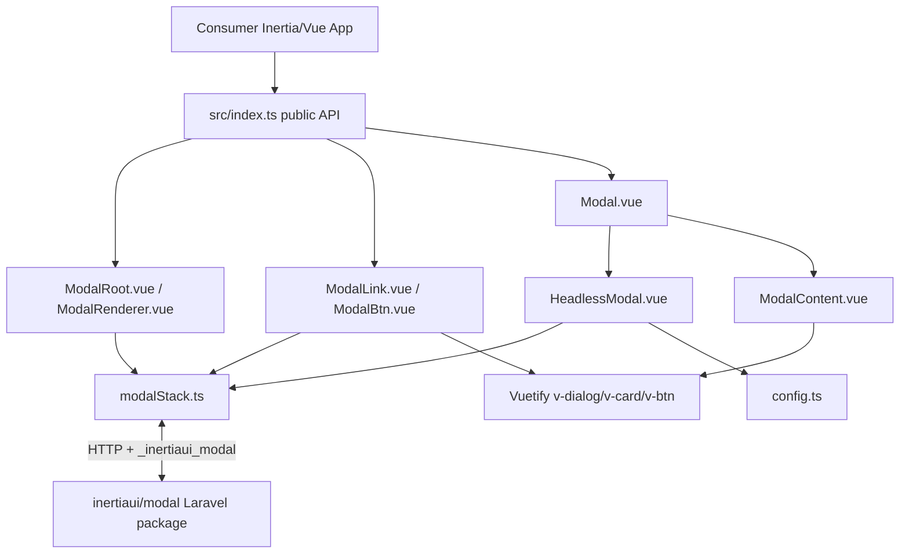

# Project Overview

`@inertia-vuetify/modal` is a Vue 3/Vuetify 4 frontend for the
`inertiaui/modal` Laravel package. It owns its modal runtime (stack, Inertia
integration, local modals, deferred props, prefetching), originally ported from
`@inertiaui/modal-vue` 3.1.2 and kept API-compatible with it, and renders
modals, slideovers, and bottom sheets with Vuetify. Vuetify-native extras
include the card layout, responsive fullscreen, `before-close`, `ModalBtn`,
and scoped Vuetify defaults. This repo also contains a Vite example app and a
Laravel/Inertia demo app for integration testing and manual verification.

## Repository Structure

- `.agents/` - Repo-owned agent skills and workflow documentation.
- `.github/` - CI (`ci.yml`) and Release Please publishing workflows.
- `_bmad/` - BMAD workflow/config files used to generate project context.
- `_bmad-output/` - Generated BMAD project context for AI agents.
- `demo-app/` - Laravel 13 + Inertia 3 + Vue/Vuetify demo application with
  Playwright end-to-end tests in `tests/e2e/`.
- `docs/` - User-facing package documentation, adapted from InertiaUI Modal's
  docs.
- `example/` - Small standalone Vite/Vue/Vuetify playground for local modals.
- `src/` - Published TypeScript package source and public exports.
- `tests/unit/` - Vitest tests that run in Node.
- `tests/browser/` - Vitest browser-mode tests that run in headless Chromium.
- `bun.lock` - Root Bun lockfile for the package workspace.
- `package.json` - Package metadata, npm exports, peer deps, and build scripts.
- `release-please-config.json` / `.release-please-manifest.json` - Release
  Please manifest config for changelog/versioning.
- `vite.config.ts` - Root Vite library build and Vitest projects.

## Build & Development Commands

Root package install (plus the browser used by the browser tests):

```sh
bun install
bunx playwright install chromium-headless-shell
```

Root package development server for `example/`:

```sh
bun run dev
```

Root package checks:

```sh
bun run lint          # oxlint
bun run format:check  # oxfmt; `bun run format` writes
bun run typecheck     # vue-tsc
bun run test          # Vitest unit + browser projects
```

Root package build (library bundle, then `vue-tsc` declarations into `dist/`):

```sh
bun run build
```

Example app build:

```sh
bun run build:example
```

Demo app setup:

```sh
cd demo-app
composer run setup
```

Demo app dev stack:

```sh
cd demo-app
composer run dev
```

Demo app SSR dev stack:

```sh
cd demo-app
composer run dev:ssr
```

Demo app frontend build:

```sh
cd demo-app
npm run build
npm run build:ssr
```

Demo app lint/format:

```sh
cd demo-app
npm run lint
npm run format:check
npm run format
```

Demo ESLint configuration regression tests:

```sh
cd demo-app
npm run lint:test
```

Demo type check (type-checks the package source through `tsconfig` `paths`):

```sh
cd demo-app
npm run typecheck
```

Demo app Pest/PHPUnit tests:

```sh
cd demo-app
composer run test
```

Demo app end-to-end tests (Playwright starts `php artisan serve` unless
`E2E_BASE_URL` points at a running app; `E2E_SSR=1` enables the SSR check):

```sh
cd demo-app
npm run build
npm run test:e2e
```

## Code Style & Conventions

- Write package source in TypeScript: `src/*.ts` modules and
  `<script setup lang="ts">` SFCs. `vue-tsc` generates the published
  declarations from them; do not hand-write `.d.ts` files.
- Use ESM syntax and preserve `"type": "module"` in root `package.json`.
- Treat `src/index.ts` as the public API; new public helpers/components need an
  explicit export there. Shared public types live in `src/types.ts`.
- Import Vuetify components explicitly (`vuetify/components/VDialog`) and use
  PascalCase tags in package SFCs. The built `dist` cannot rely on global
  registration or `vite-plugin-vuetify` auto-imports in consumer apps.
- Prefer Vue `<script setup>` and Composition API primitives already in use.
- Root formatting and linting use oxfmt (`.oxfmtrc.json`: 4 spaces, no
  semicolons, single quotes) and oxlint (`.oxlintrc.json`). YAML and
  `package.json` keep their 2-space formatting and are excluded from oxfmt.
- Use PascalCase for Vue component filenames and camelCase for TS identifiers.
- Preserve consumer-facing `im-` CSS classes as public customization hooks.
- Demo TypeScript is strict in `demo-app/tsconfig.json`. Demo ESLint uses Vue
  essential, TypeScript ESLint recommended, the Vue parser, and Prettier
  (`demo-app/.prettierrc`); `npm run lint:test` checks those rules.
- Commit messages should use Conventional Commits (`feat:`, `fix:`, `docs:`,
  `refactor:`, `test:`, `chore:`); Release Please maps these to changelog
  sections.

## Architecture Notes



The runtime files keep the names of their `@inertiaui/modal-vue` originals
(`modalStack.ts`, `ModalRoot.vue`, `ModalRenderer.vue`, `HeadlessModal.vue`,
`ModalLink.vue`, `Deferred.vue`, `WhenVisible.vue`, `cache.ts`, `helpers.ts`,
`useModal.ts`, `config.ts`) so upstream changes can be diffed file by file;
`app.ts` holds `renderApp`/`withInertiaModal`. `modalStack.ts` owns the stack
of `ModalInstance`s, requests modals and partial reloads over Inertia's `http`
client with the `X-Inertia*` and `X-InertiaUI-Modal*` headers, loads deferred
props, caches prefetches, and pushes navigate-mode URLs. `ModalRoot.vue` opens
modals that arrive in a page's `_inertiaui_modal` prop, closes them on
navigation or when a non-GET visit finishes on a page without one, and adds the
base-URL header to Inertia requests (browser only). `HeadlessModal.vue`
resolves each modal's config (props, then visit config, then `config.ts`
defaults) and exposes the public slot props and methods.

`Modal.vue` wraps `HeadlessModal` and adds `title`, `beforeClose`,
`dialogProps`, `cardProps`, and the `title`/`actions` slots. `ModalContent.vue`
renders one `v-dialog` + `v-card` for every variant: `closeExplicitly` →
`persistent` (top modal only), `position` → `location`, `maxWidth` →
`max-width`, `fullscreen` → `fullscreen` via `useDisplay`, and only the top
modal gets a scrim. Slideovers are full-height dialogs on a physical side
(RTL-aware) or bottom sheets, animated by `src/transitions.ts`. Centered modals
pass the opening element as the dialog `target`, so Vuetify's transition grows
from it. The content area scrolls while the optional header, close button,
and actions stay put. User-initiated closes go through `requestClose`, which
runs `beforeClose` and bounces the dialog when vetoed; `close()` bypasses it.
It calls `modalContext.afterLeave` from the dialog's `after-leave`, provides
`modalContext` so local modal content can call `useModal()`, scopes
`InertiaModal` Vuetify defaults, marks the configured `appElement`
`aria-hidden` while open, and returns focus to the opening element. Vuetify's
own scroll blocking and focus trap are used.

`config.ts` owns the defaults (Vuetify classes, `fullscreen: 'sm'` for modals)
and maps max-width tokens to Tailwind's widths and modal positions to Vuetify
locations; unknown max-width tokens intentionally fall back to `2xl`.

The root library build outputs one ESM bundle to `dist/` with no CSS and keeps
Vue, Vuetify, `@inertiajs/*`, and `@inertiaui/vanilla` external; `vue-tsc` then
writes declarations to `dist/`, which serve both `.` and `./src` exports. The
demo app aliases `@inertia-vuetify/modal` to `../src/index.ts` (and
`tsconfig` `paths` to the same file), dedupes Vue/Vuetify/Inertia/vanilla
imports to its own `node_modules`, and must declare the package's runtime
dependencies itself.

## Testing Strategy

- Minimum verification for package source/export changes: `bun run lint`,
  `bun run typecheck`, `bun run test`, and `bun run build`.
- `tests/unit/` covers config, helpers, the modal stack (with Inertia's `http`
  client mocked), and `ModalRoot`'s router handling (rendered with
  `renderToString`, router events replayed by hand).
- `tests/browser/` mounts real Vuetify dialogs in headless Chromium with real
  transitions (`stubs: { transition: false }`), keyboard, and pointer events,
  and drives local modals through the modal stack. Extend it for lifecycle or
  layout changes.
- Check that a new test fails when the behavior it covers is removed.
- Vitest 5 clears mock calls before each test (`clearMocks: true`): assert
  calls in the test that made them, not in a `beforeAll`.
- Browser tests run in a phone-sized viewport unless they set one; the shared
  `reset()` helper sets 1280×800 because centered modals go fullscreen below
  `sm`.
- In wait conditions, assert `toBeTruthy()` on optional chains: an `undefined`
  element passes `not.toBeNull()` and makes the wait return immediately.
- The DOM is not proof of cleanup: Vuetify removes a closed dialog's overlay
  even when `afterLeave` never ran. Check that `useModalStack().stack` empties.
- For integration-facing changes, also run `bun run build:example`, the demo
  type check and builds, and `npm run test:e2e` in `demo-app`. The e2e suite
  covers routed modals, validation, closing after a save, `before-close`,
  navigate mode with back, nested stacks and their events, deferred props,
  reloads, prefetching, direct modal URLs, fullscreen, and SSR (with
  `E2E_SSR=1`).
- Demo Laravel tests run through `composer run test`; they cover the demo's
  modal routes, not package behavior.
- For visual changes, check modal, slideover, bottom sheet, card layout, and
  phone fullscreen in light and dark themes. Use `example/` for local modals
  and `demo-app/` for routed, navigate-mode, and SSR behavior.
- For packaging changes, test both published root exports and the demo alias to
  `src/index.ts`.

## Security & Compliance

- Do not commit real `.env` files or secrets. `demo-app/.env.example` is the
  committed template.
- Keep Vue, Vuetify, `@inertiajs/*`, and `@inertiaui/vanilla` external in the
  root Vite build to avoid duplicate runtimes and broken injection/state.
- The package is MIT. Its runtime is derived from InertiaUI Modal (MIT), so
  `LICENSE` carries both notices; keep them when porting more upstream code.
- Release Please owns release versioning and changelog updates unless the user
  explicitly requests a release task.
- npm trusted publishing is bound to the `inertia-vuetify/modal` repository and
  `.github/workflows/release-please.yml`; renaming the workflow file or changing
  `repository.url` in `package.json` breaks publishing.
- If blocked by a bug/gap in a dependency owned by `gigerit`, do not patch or
  work around it in this consuming project. Stop and report package, version,
  expected/actual behavior, repro path, and suggested upstream fix.

> TODO: No dependency scanning, SAST, or license scanning config is present in
> this checkout.

## Agent Guardrails

- Treat the worktree as shared. Do not alter, stage, commit, move, delete, or
  reformat unrelated changes.
- Do not remove or rename public exports, props, slots, events, exposed methods,
  or `im-` CSS classes without an explicit breaking-change decision.
- Keep the wire protocol compatible with the `inertiaui/modal` Laravel
  package: request headers (`X-InertiaUI-Modal`, `X-InertiaUI-Modal-Base-Url`,
  `X-Inertia*`), the `_inertiaui_modal` page prop, and the modal response
  shape (`component`, `props`, `url`, `baseUrl`, `meta.deferredProps`). Check
  the package's PHP source before changing any of them.
- Keep the public API compatible with `@inertiaui/modal-vue` (export names,
  props, slot props, events, exposed methods) unless a breaking change is
  decided. Port upstream changes with the `sync-inertia-modal-upstream` skill;
  `UPSTREAM.md` lists the divergences to keep.
- Config keys a link or visit can pass are listed in `modalPropNames`;
  `title`, `beforeClose`, `dialogProps`, and `cardProps` stay `Modal`-only.
- `closeExplicitly` maps to `v-dialog` `persistent`, which blocks backdrop and
  Escape. Browser back belongs to Inertia and `ModalRoot`; Vuetify's
  `close-on-back` only works with vue-router, so keep it `false`.
- Bind `v-dialog` props the package does not need to force as `undefined`
  (e.g. `scrim` on the top modal, `persistent` when false), so `dialogProps`
  and `InertiaModal` Vuetify defaults can apply. Content defaults must nest
  under `InertiaModal.VDialog` because `v-dialog` re-roots its content defaults.
- The package ships no CSS: Vite library builds do not inject it, and consumers
  could not import it. Express layout through `v-dialog` props, `content-props`
  styles, inline styles, and Vuetify utility classes. Vuetify dialog content is
  teleported, so any consumer CSS must use global selectors.
- Keep `paddingClasses`/`panelClasses` defaults Vuetify classes: upstream's
  Tailwind defaults (`bg-white rounded`) are real Vuetify utilities and break
  dark themes.
- Preserve stacked-modal behavior: only top modal gets scrim, covered modals use
  `aria-hidden`, and modal context controls focus/blur state.
- Stacked modals render beside their parent, not inside its `v-dialog`, so
  Vuetify treats clicks in a child as outside clicks on the parent. Covered
  modals must ignore click-outside closes and must not be `persistent` (it
  would bounce them).
- `false` is meaningful for class and close-button config. Do not replace
  nullish/boolean semantics with truthy defaults without compatibility review.
- Keep generated outputs such as `dist/`, `demo-app/vendor/`, `node_modules/`,
  and Laravel cache/storage artifacts out of manual edits unless the task
  explicitly targets them.
- Do not edit `_bmad-output/project-context.md` casually. Update it only when
  the user asks for BMAD/project-context regeneration or repo-wide agent facts
  materially change.

## Extensibility Hooks

- Public exports live in `src/index.ts`; public types in `src/types.ts`.
- `getConfig`, `putConfig`, and `resetConfig` live in `src/config.ts`.
- Mount Inertia apps with `renderApp(App, props)` (or wrap an existing app
  with `withInertiaModal(app)`), which renders `ModalRoot`.
- `ModalLink` renders any tag or component (`as`); `ModalBtn` is the Vuetify
  button variant with a loading state.
- `Modal` accepts the modal config (`closeButton`, `closeExplicitly`,
  `closeOnClickOutside`, `maxWidth`, `paddingClasses`, `panelClasses`,
  `position`, `slideover`, `fullscreen`) plus `title`, `beforeClose`,
  `dialogProps`, and `cardProps`.
- `createVuetify({ defaults: { InertiaModal: { VDialog: { ... } } } })` styles
  all modals without affecting other dialogs.
- `getMaxWidth()` and `getDialogLocation()` are package helper hooks in
  `src/config.ts`.
- Demo app Vite aliases can be adjusted in `demo-app/vite.config.ts` when
  testing source versus built package behavior; keep `tsconfig.json` `paths`
  in sync.
- Environment variables follow Laravel/Vite conventions in `demo-app/.env*`,
  including `VITE_APP_NAME`.

## Further Reading

- [README.md](README.md)
- [UPSTREAM.md](UPSTREAM.md)
- [CHANGELOG.md](CHANGELOG.md)
- [docs/introduction.md](docs/introduction.md)
- [docs/installation.md](docs/installation.md)
- [docs/basic-usage.md](docs/basic-usage.md)
- [docs/configuration.md](docs/configuration.md)
- [docs/close-modal.md](docs/close-modal.md)
- [docs/styling.md](docs/styling.md)
- [docs/modal-props.md](docs/modal-props.md)
- [docs/nested-stacked-modals.md](docs/nested-stacked-modals.md)
- [docs/headless-mode.md](docs/headless-mode.md)
- [example/README.md](example/README.md)
- [_bmad-output/project-context.md](_bmad-output/project-context.md)
